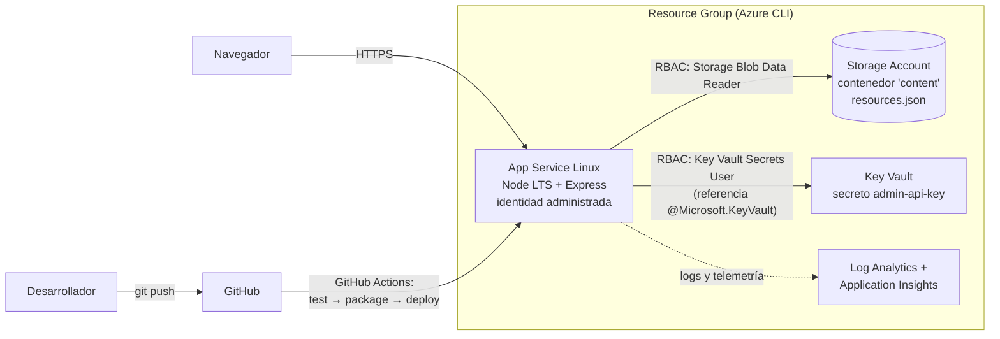

# Wiñay

Aplicación web de educación financiera para jóvenes peruanos. Con los gastos del mes que ingresa el usuario, analiza sus hábitos con la regla 50/30/20, sugiere consejos con recursos para aprender más y permite simular una meta de ahorro con interés compuesto. Proyecto final del Azure Bootcamp (LEAD LEARN by UTP), desplegado en Microsoft Azure.

*Wiñay* es una palabra quechua que se relaciona con crecer: la idea es que el ahorro y el conocimiento financiero crecen con el tiempo.

🌐 **Aplicación:** https://app-winay-10015.azurewebsites.net

## 💡 Qué hace

| Módulo | Descripción |
|---|---|
| Mis gastos | El usuario ingresa su ingreso mensual y sus gastos, uno por uno con calendario o cargando un ejemplo. La API clasifica cada gasto (comercios peruanos como Rappi, Wong, Yape, Movistar, etc.), calcula el reparto necesidades/gustos/ahorro y detecta hábitos: delivery frecuente, suscripciones acumuladas, gastos hormiga y carga de deuda. |
| Consejos | Un motor de reglas convierte esos hábitos en recomendaciones priorizadas por severidad, cada una con acciones concretas y recursos de aprendizaje relacionados. |
| Simulador de ahorro | Aporte mensual, TEA, plazo, monto inicial y meta opcional. Calcula el total, el interés ganado y en cuántos meses se alcanza la meta. |
| Biblioteca | Guías breves y enlaces a fuentes oficiales de la SBS, filtrables por tema. El catálogo se lee desde Azure Blob Storage. |

Los gastos se procesan en memoria durante la solicitud y no se almacenan. La aplicación no tiene base de datos.

## 🏗️ Arquitectura



### Arquitectura del código (por capas)

```
src/
├── server.js            Composition root: conecta implementaciones concretas
├── app.js               Fábrica de Express (helmet, rate limit, rutas, errores)
├── config/              Configuración desde variables de entorno
├── routes/              Definición de endpoints /api/v1
├── controllers/         Traducen HTTP ⇄ servicios (sin lógica de negocio)
├── services/            Lógica de negocio pura y testeable
│   ├── spending-analysis.service.js   métricas 50/30/20 y hábitos
│   ├── recommendation.service.js      motor de reglas (una función por regla)
│   ├── insights.service.js            orquesta análisis + consejos + recursos
│   ├── savings-simulator.service.js   interés compuesto y meta
│   └── content.service.js             catálogo con caché TTL y respaldo
├── repositories/        Acceso a datos: Blob Storage (managed identity) o archivo local
├── domain/              Taxonomía de categorías y comercios
├── schemas/             Validación de entrada con zod
├── middleware/          request-id y logs, validación, API key, errores
└── utils/
```

Decisiones de diseño:

- **Inyección de dependencias:** `createApp({...})` recibe sus servicios, por eso las pruebas de integración usan repositorios falsos sin tocar Azure.
- **Repositorio intercambiable:** si existe `STORAGE_ACCOUNT_NAME` se lee de Blob Storage; si falla, usa el archivo local y marca la respuesta como `degraded`.
- **Sin secretos en el código:** Blob se accede con identidad administrada (`DefaultAzureCredential`, sin claves) y la API key de administración viaja por Key Vault.
- **Errores uniformes:** toda falla responde `{ error: { code, message, details, requestId } }`.
- **Logs estructurados en JSON** con `requestId`, listos para consultarse en Log Analytics.

## 🔌 API

Base: `/api/v1`

| Método | Ruta | Descripción |
|---|---|---|
| GET | `/health` | Estado, versión y fuente del contenido |
| GET | `/resources?tag=` | Catálogo de recursos, filtrable por tema |
| POST | `/insights/spending` | Análisis de gastos + consejos personalizados |
| POST | `/simulations/savings` | Simulación de ahorro |
| POST | `/admin/content/refresh` | Recarga el catálogo (header `x-api-key`) |

Ejemplo:

```bash
curl -X POST http://localhost:3000/api/v1/insights/spending \
  -H "Content-Type: application/json" \
  -d '{
    "monthlyIncome": 3200,
    "transactions": [
      {"date": "2026-09-01", "description": "Alquiler cuarto", "amount": 650},
      {"date": "2026-09-03", "description": "Rappi pedido", "amount": 38}
    ]
  }'
```

## ☁️ Temas de Azure cubiertos

| Clase del bootcamp | Qué se implementó | Dónde |
|---|---|---|
| Azure CLI y grupos de recursos | Todos los recursos se crean con comandos `az`, paso a paso y comentados | [`scripts/azure-setup.sh`](scripts/azure-setup.sh) (pasos 0 a 2) |
| Cómputo: App Service | Web App Linux con Node LTS, health check, HTTPS obligatorio, TLS 1.2 | [`scripts/azure-setup.sh`](scripts/azure-setup.sh) (paso 6) |
| Almacenamiento | Storage Account con contenedor privado; el catálogo se sirve desde Blob | [`scripts/azure-setup.sh`](scripts/azure-setup.sh) (paso 4), [`blob-content.repository.js`](src/repositories/blob-content.repository.js) |
| Identidad: Entra ID, RBAC e identidades administradas | Identidad asignada por el sistema + roles de mínimo privilegio | [`scripts/azure-setup.sh`](scripts/azure-setup.sh) (paso 7) |
| Secretos, cifrado y monitoreo | Key Vault con RBAC y referencia desde App Settings; Log Analytics y Application Insights | [`scripts/azure-setup.sh`](scripts/azure-setup.sh) (pasos 3, 5 y 8) |
| CI/CD | GitHub Actions: pruebas, paquete, despliegue y prueba de humo | [`.github/workflows/`](.github/workflows) |

### Mejoras futuras

- Contenedores: Dockerfile y Azure Container Apps.
- Redes virtuales: integración con VNet y private endpoints para Storage y Key Vault.
- Azure Data Factory: ingesta de extractos bancarios.
- Azure AI Foundry: consejos generados por un agente de IA sobre el mismo motor de reglas.
- Autenticación del despliegue con OIDC en lugar del publish profile.

## 🚀 Ejecutar en local

```bash
npm install
npm test
npm start        # http://localhost:3000
```

Sin `STORAGE_ACCOUNT_NAME`, el catálogo se lee de `data/content/resources.json`. Las variables disponibles están en [`.env.example`](.env.example).

## 📦 Despliegue

Guía completa paso a paso en [`docs/DEPLOY.md`](docs/DEPLOY.md). Resumen:

1. `az login` y `bash scripts/azure-setup.sh`: crea los recursos y sube el catálogo `resources.json`.
2. Configurar en GitHub el secreto `AZURE_WEBAPP_PUBLISH_PROFILE` y la variable `AZURE_WEBAPP_NAME`.
3. `git push` a `main`: el pipeline prueba, empaqueta y despliega.

## 🔒 Seguridad

- HTTPS obligatorio, TLS 1.2 mínimo, FTP deshabilitado.
- Cabeceras de seguridad con Helmet (incluye CSP) y límite de solicitudes por IP.
- Validación estricta de entradas con zod y límite de tamaño del cuerpo.
- Sin acceso público al contenedor de Blob; el acceso es por identidad administrada.
- Comparación de la API key en tiempo constante; la API de administración se desactiva si no hay clave.
- El front end escribe en el DOM solo con `textContent`, sin `innerHTML`.

## 🛠️ Herramientas utilizadas

Visual Studio Code, Node.js, Azure CLI, Git y GitHub.

## 👩‍💻 Autora

Karen Huamán · Azure Bootcamp, LEAD LEARN by UTP · 2026

1. Grupo de recursos con todos los recursos creados
2. App Service en ejecución
3. Contenedor `content` con `resources.json`
4. Key Vault con el secreto y la asignación de roles
5. Workflow de GitHub Actions en verde
6. La aplicación en el navegador (Mis gastos, Simulador y Biblioteca)

## Aviso

Herramienta educativa. Los consejos y simulaciones son referenciales y no constituyen asesoría financiera.